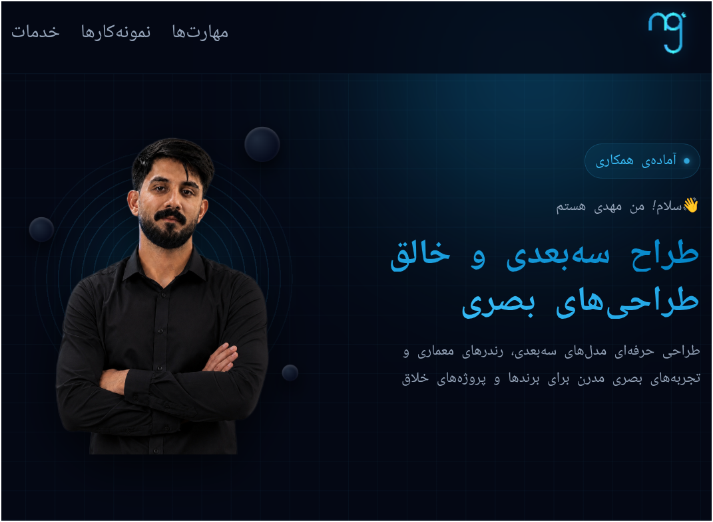

#  MgArts | 3D Artist Portfolio

### A modern, fully responsive portfolio website for a 3D artist.

  

 

 

[🌐 Live Demo](https://mahdyarqzv005-byte.github.io/MgArts/)

---

##  About The Project

This project is a custom-designed portfolio website built from scratch for a 3D artist. The goal was to create a sleek, dark-themed platform to showcase 3D models, architectural renders, and creative visual experiences. 

The design focuses on a modern, space-inspired aesthetic with smooth animations and a clean user interface.

## ✨ Key Features

-  **Dark & Modern UI** — Space-inspired theme with orbital elements and subtle gradients.
-  **Fully Responsive** — Optimized for mobile, tablet, and desktop.
-  **Hero Section** — Eye-catching profile area with a professional introduction.
-  **Skills Showcase** — Clean UI displaying proficiency in Blender, Photoshop, and Illustrator.
-  **Project Gallery** — A grid layout to display 3D models with software tags.
-  **Services Section** — Clear presentation of offered services (Logo design, Banners, 3D Modeling, Animation).
- **Smooth Animations** — Subtle hover effects and transition animations for a premium feel.

## Built With

- **HTML5** — Semantic structure.
- **CSS3** — Custom properties (variables), Flexbox, Grid, and keyframe animations.
